  

# 🚀 Awesome Hybrid Transactional/Analytical Processing (HTAP)

  
  
  
  
  
  

> ⚡ A curated collection of leading SaaS cloud platforms, distributed SQL databases, and open-source engines for **Hybrid Transactional/Analytical Processing (HTAP)** and real-time operational analytics without legacy ETL pipelines.

---

## 📑 Table of Contents

- [🌐 Sector Overview & Market Dynamics](#-sector-overview--market-dynamics)
- [☁️ SaaS & Managed Cloud Platforms](#️-saas--managed-cloud-platforms)
- [💻 Open-Source GitHub Projects](#-open-source-github-projects)
- [🏗️ Architectural Comparison: True HTAP vs. MPP OLAP](#️-architectural-comparison-true-htap-vs-mpp-olap)
- [📈 Star History](#-star-history)
- [🤝 Support & Sponsorship](#-support--sponsorship)
- [🤝 How to Contribute](#-how-to-contribute)
- [⚖️ Disclaimer & License](#️-disclaimer--license)

---

## 🌐 Sector Overview & Market Dynamics

The global Hybrid Transactional/Analytical Processing (HTAP) market is estimated at approximately **$8.2 billion in 2026** and projected to surpass **$30 billion by the early 2030s**, compounding at a CAGR of ~24%. The sector exhibits a **moderately fragmented architecture with dual-layer consolidation**: hyperscale cloud providers (Microsoft Azure, AWS, Google Cloud, Oracle) capture dominant operational workloads through serverless HTAP integrations (e.g., Azure Synapse Link, Aurora Limitless, AlloyDB, Spanner TrueTime), while specialized distributed SQL and real-time columnar engines (TiDB, SingleStore, CockroachDB, Snowflake Unistore) retain strong, defensible developer niches through sub-second analytical concurrency, decoupled compute-storage scaling, and native zero-ETL primitives.

---

## ☁️ SaaS & Managed Cloud Platforms

The table below lists the leading commercial and fully managed SaaS/PaaS platforms offering HTAP, distributed SQL, or converged operational-analytical query capabilities. Entries are sorted in descending order by **parent company size** (market capitalization / valuation / annual revenue).

| 🏢 Platform | 🏷️ Provider / Company | 💰 Company Size (Valuation / Market Cap / Rev) | 💳 Starting Tier Pricing | 🎁 Free Tier / Trial Limit | ⚡ Key HTAP Capabilities |
| :--- | :--- | :--- | :--- | :--- | :--- |
| **[Azure Cosmos DB](https://azure.microsoft.com/en-us/products/cosmos-db)** | Microsoft | ~$3.1T Market Cap | Serverless: $0.25 per 1M RU/s + $0.25/GB storage; Provisioned: ~$0.008/hour per 100 RU/s | **Free Forever**: 1,000 RU/s throughput + 25 GB storage per month free indefinitely across all APIs | Multi-model distributed NoSQL/relational database with **Azure Synapse Link**, providing zero-ETL, near-real-time analytical execution over operational stores. |
| **[AWS Aurora Limitless Database](https://aws.amazon.com/rds/aurora/)** | Amazon Web Services (AWS) | ~$1.9T Market Cap (Amazon) | $0.12 per Aurora Capacity Unit (ACU-Hour) + $0.10/GB-month storage | **Free Trial**: AWS Free Tier offers 750 hours/month of db.t3.micro or db.t4g.micro single-AZ instances for 12 months (standard Aurora) | Distributed PostgreSQL-compatible engine featuring horizontally scaled multi-sharding, high-throughput OLTP writes, and distributed transactional read-analytics without cross-region ETL. |
| **[Google Cloud Spanner](https://cloud.google.com/spanner)** | Google Cloud (Alphabet) | ~$1.9T Market Cap (Alphabet) | $0.09 per Spanner Processing Unit (PU) hour (~$65.70/month for 100 PUs base instance) + $0.30/GB storage | **Free Trial**: $300 in free Cloud credits valid for 90 days across all Google Cloud services | Globally distributed relational database with **TrueTime** synchronization, external serializability, federated BigQuery pushdowns, and HTAP query parallelization. |
| **[AlloyDB for PostgreSQL](https://cloud.google.com/alloydb)** | Google Cloud (Alphabet) | ~$1.9T Market Cap (Alphabet) | $0.0867 per vCPU/hour + $0.0173 per GB RAM/hour (~$0.48/hr for a 4 vCPU, 32 GB node) | **Free Trial**: $300 Google Cloud credit valid for 90 days; includes AlloyDB free trial instance credits | Managed PostgreSQL-compatible database featuring an in-memory columnar engine, ML-driven vector search, and analytical scan acceleration over operational tables. |
| **[Oracle HeatWave](https://www.oracle.com/heatwave/)** | Oracle | ~$400B Market Cap | ~$0.16 per HeatWave Node hour (~$115/month per node) on Oracle Cloud Infrastructure (OCI) | **Free Forever + Trial**: $300 free trial credits for 30 days + OCI "Always Free" tier (includes 2 Autonomous DB instances with 20 GB storage each) | In-memory massively parallel columnar query accelerator built into MySQL, eliminating external ETL and running real-time analytics, machine learning, and generative AI queries natively. |
| **[Snowflake Hybrid Tables (Unistore)](https://www.snowflake.com/)** | Snowflake | ~$45B Market Cap | Standard Edition starts at $2.00 per Snowflake Credit consumed (~$2.00/warehouse compute-hour) | **Free Trial**: 30-day free trial with $400 worth of free compute and storage credits | Unistore architecture with Hybrid Tables providing low-latency, row-level ACID transactions that can be joined inline directly against analytical column-oriented data lake tables. |
| **[CockroachDB Dedicated](https://www.cockroachlabs.com/)** | Cockroach Labs | ~$5B Valuation | CockroachDB Standard: $0.10 per vCPU hour + $0.05 per 100K request units (Dedicated begins at ~$0.27/vCPU/hr) | **Free Forever**: CockroachDB Serverless grants 50 million Request Units (RUs) and 10 GB storage free each month | Distributed SQL engine with serializable isolation, geo-partitioning, distributed analytical query cost models, and vector search. |
| **[PingCAP TiDB Cloud](https://www.pingcap.com/)** | PingCAP | ~$3B Valuation | Serverless: $0.10 per 1M Request Units (RU) + $0.25/GB-month storage (Dedicated from ~$0.20/vCPU/hr) | **Free Forever**: TiDB Cloud Serverless provides 25 million Request Units (RUs) and 5 GB storage free every month | Distributed MySQL-compatible database pairing **TiKV** (row-store OLTP) and **TiFlash** (columnar OLAP) with automatic raft-based synchronization for isolated HTAP execution. |
| **[SingleStore Helios](https://www.singlestore.com/)** | SingleStore | ~$1.3B Valuation | Compute starts at $0.65 per compute unit per hour (S-0.5 tier) + $0.05 per GB-month storage | **Free Trial**: $600 in free trial credits valid for up to 30 days | Universal Storage technology combining row and columnar representations within a single engine for sub-second analytical queries, vector similarity search, and high-velocity transactional ingestion. |
| **[MariaDB SkySQL](https://mariadb.com/skysql/)** | MariaDB | ~$100M Valuation / Revenue Run-rate | SkySQL starts at ~$0.17 per vCPU hour (~$120/month for entry-level managed node) | **Free Trial**: 14-day free trial with $500 in cloud usage credits | Cloud Database-as-a-Service delivering hybrid transactional and analytical processing powered by the MariaDB ColumnStore plugin. |

---

## 💻 Open-Source GitHub Projects

The following open-source projects provide native HTAP architectures, distributed SQL engines, or analytical databases capable of operational analytics. Repositories are sorted in descending order by **GitHub Star Count**. Click on any star badge to navigate to the project's stargazers page.

| 📦 Repository | ⭐ Stars | 🏛️ Primary Architecture | 📝 Description | 📜 License |
| :--- | :---: | :--- | :--- | :--- |
| **[ClickHouse](https://github.com/ClickHouse/ClickHouse)** |  | Column-Oriented DBMS / Real-Time OLAP | Ultra-fast column-oriented database management system for real-time analytical reporting and operational metric streaming using SQL. | Apache-2.0 |
| **[DuckDB](https://github.com/duckdb/duckdb)** |  | In-Process Columnar OLAP Engine | Embeddable analytical SQL database engine ("SQLite for Analytics") designed for high-performance operational vector and column analytics. | MIT |
| **[TiDB](https://github.com/pingcap/tidb)** |  | Native Distributed HTAP (TiKV + TiFlash) | Flagship distributed SQL database featuring decoupled row-store (TiKV) and columnar store (TiFlash) with real-time replication and zero OLTP interference. | Apache-2.0 |
| **[CockroachDB](https://github.com/cockroachdb/cockroach)** |  | Distributed SQL / Strong Consistency | Cloud-native distributed SQL engine built on multi-region serializability, automated horizontal sharding, and vectorized analytical query execution. | BSL 1.1 / CCL |
| **[TimescaleDB](https://github.com/timescale/timescaledb)** |  | PostgreSQL Extension (Time-Series & HTAP) | Extends PostgreSQL with automated chunk-based Hypertables, columnar compression, and hybrid analytical querying over continuous streaming data. | Timescale License / Apache-2.0 |
| **[Apache Doris](https://github.com/apache/doris)** |  | Real-Time MPP Analytical Database | High-performance MPP analytical database supporting real-time data ingestion, high-concurrency point queries, and low-latency interactive OLAP. | Apache-2.0 |
| **[Citus](https://github.com/citusdata/citus)** |  | Distributed PostgreSQL Extension | Transforms standard PostgreSQL into a distributed database sharding tables and parallelizing transactional and analytical queries across cluster nodes. | AGPL-3.0 |
| **[StarRocks](https://github.com/StarRocks/starrocks)** |  | Vectorized MPP Lakehouse Engine | Sub-second real-time analytical database featuring a fully vectorized SIMD execution engine, real-time mutable tables, and lakehouse query acceleration. | Apache-2.0 |
| **[YugabyteDB](https://github.com/yugabyte/yugabyte-db)** |  | Distributed SQL (PostgreSQL & Cassandra API) | High-performance distributed SQL database designed for cloud-native transactional workloads with multi-region consistency and analytical parallel scanning. | Apache-2.0 |
| **[OceanBase](https://github.com/oceanbase/oceanbase)** |  | Enterprise Distributed HTAP Database | High-concurrency enterprise distributed relational database designed for ultra-high transaction throughput and real-time mixed HTAP workloads. | MulanPubL-2.0 |
| **[ParadeDB](https://github.com/paradedb/paradedb)** |  | PostgreSQL Search & Analytics Engine | Modern elastic search and columnar analytical engine built natively on PostgreSQL, replacing Elasticsearch for hybrid text, vector, and analytical workloads. | AGPL-3.0 |
| **[Hydra Columnar](https://github.com/hydradatabase/columnar)** |  | Open-Source Columnar Postgres Extension | Open-source columnar data store for PostgreSQL engineered to aggregate massive operational datasets and run operational analytics directly within Postgres. | Apache-2.0 |
| **[MatrixOne](https://github.com/matrixorigin/matrixone)** |  | Hyper-Converged Cloud-Native Database | Hyper-converged cloud-native database that consolidates OLTP, OLAP, and streaming into a unified engine with decoupled storage and compute. | Apache-2.0 |

---

## 🏗️ Architectural Comparison: True HTAP vs. MPP OLAP

When evaluating systems in this ecosystem, database architects distinguish between three primary design paradigms:

1. **Native Dual-Engine HTAP (e.g., TiDB, Snowflake Unistore)**:
   - Stores transactions in a row format (e.g., RocksDB-backed TiKV) for low-latency atomic writes.
   - Automatically replicates modifications via Raft/WAL to a synchronized columnar format (e.g., TiFlash) for vector scans without lock contention or query degradation.

2. **Converged Universal Storage (e.g., SingleStore, OceanBase, MatrixOne)**:
   - Uses unified hybrid data blocks containing column segment files with in-memory row write buffers to serve concurrent mixed workloads directly from a single storage layer.

3. **High-Speed MPP Real-Time OLAP (e.g., Apache Doris, StarRocks, ClickHouse)**:
   - Highly optimized for sub-second analytical aggregations and streaming batch ingest, but typically does not support multi-row interactive ACID transactions.

---

##  Star History

---

## 💖 Support & Sponsorship

Thank you for visiting and supporting **Awesome Hybrid Transactional/Analytical Processing (HTAP)**! 🙌

If you found this resource helpful, please consider:
- ⭐ **Starring** the repository on GitHub
- 🍴 **Forking** it to keep a personal copy or contribute improvements
- 📢 **Sharing** with your network, team, or developer community
- ☕ Buying me a coffee by sponsoring on the [GitHub Sponsor Dashboard](https://github.com/sponsors/ishandutta2007)

Your support motivates continuous curation and maintenance of this list!

---

## 🤝 How to Contribute

We welcome community contributions! To add a new platform, database engine, or correct data:

1. **Fork** the repository on GitHub.
2. Create a new branch: `git checkout -b feature/add-new-htap-system`.
3. Update `README.md` keeping tabular formatting, specific pricing/free tier data, star badges, and proper categorization.
4. Submit a well-described **Pull Request**.

---

## ⚖️ Disclaimer & License

- This list is curated for educational and architectural evaluation purposes. Product names and trademarks belong to their respective owners.
- Pricing, free tiers, and feature capabilities change over time; please verify with each vendor's official documentation before making procurement decisions.
- Distributed under the [MIT License](LICENSE).
